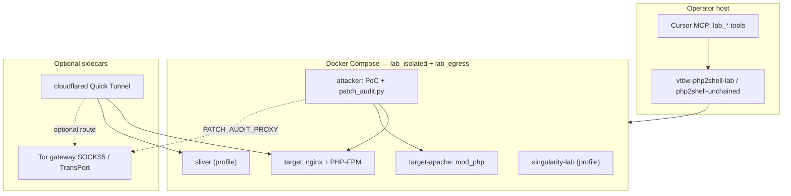

<p align="center">
  <strong>PHP2Shell Unchained</strong><br>
  <em>Isolated adversary-emulation lab for PHP Session Upload Progress (PHP2Shell) chains, mitigations, and blue-team validation</em>
</p>

<p align="center">
  <a href="https://github.com/Leviticus-Triage/php2shell-unchained/actions"></a>
  
  
  
  
  
  
  
</p>

<p align="center">
  <a href="https://nvd.nist.gov/vuln/detail/CVE-2026-109618"></a>
  <a href="https://nvd.nist.gov/vuln/detail/CVE-2026-109619"></a>
  <a href="https://www.php.net/archive/2026.php"></a>
  <a href="https://calif.io/php2shell/"></a>
</p>

---

**Maintainer:** [Leviticus-Triage](https://github.com/Leviticus-Triage)

PHP2Shell Unchained is a **self-contained Docker lab** for security engineering teams, platform operators, and application developers who need to **reproduce**, **exercise**, and **measure** PHP2Shell-related attack paths and vendor or emergency mitigations—without touching production systems.

The lab bundles multiple public research chains (FPM + LFI, mod_php heap, Jackalsyn framework slot), optional **Sliver** post-exploitation emulation, **Cloudflare Quick Tunnel** inbound perspective, optional **Tor** egress for outbound obfuscation, an **11-scenario patch / WAF audit engine**, and a **guided workarounds runner** with session logs and Markdown evaluation output.

> **Scope:** Authorized testing only—your lab hosts, your CI images, or explicitly permitted targets. See [SECURITY.md](SECURITY.md).

---

## Who this is for

| Role | What you get |
|------|----------------|
| **System / platform admins** | Repeatable Docker stacks, `workarounds run` to validate ini/FPM/WAF changes, `doctor` health checks, version matrix against fixed PHP releases |
| **Application developers** | Understand Chain A (session file + LFI), upload-progress configuration, and why `ini_set()` timing matters for CVE-2026-115560 |
| **Security / red & blue teams** | Exploit-path comparison, WAF Top-10 bypass probes, external-attacker mode (tunnel ± Tor), Singularity LKM detection exercises, JSONL audit trails |

---

## Architecture (logical)



**Networks:** `lab_isolated` (no direct internet) carries target ↔ attacker traffic; `lab_egress` allows controlled outbound (module fetches, Tor exits). Details: [docs/DOCUMENTATION.md](docs/DOCUMENTATION.md#4-netze-und-dienste).

---

## Vulnerability context (reference)

| ID | CVSS (NVD) | Mechanism (summary) | Fixed PHP (vendor) |
|----|------------|---------------------|---------------------|
| [CVE-2026-109618](https://nvd.nist.gov/vuln/detail/CVE-2026-109618) | 9.2 | OOM / `longjmp` leaves uninitialized request state → memory corruption → RCE | 8.2.35, 8.3.36, 8.4.27, 8.5.12 |
| [CVE-2026-109619](https://nvd.nist.gov/vuln/detail/CVE-2026-109619) | 9.2 | Stale global state after fatal error on upload-progress path → UAF → RCE | same |
| [CVE-2026-115560](https://www.php.net/archive/2026.php) | advisory | `serialize_handler` switch + upload progress enabled | next bugfix train; interim: `session.upload_progress.enabled=0` |

**Further reading:** [Calif Research — PHP2Shell](https://calif.io/php2shell/) · [CERT-EU SA 2026-018](https://www.cert.europa.eu/publications/security-advisories/2026-018/) · [PHP.net 2026 archive](https://www.php.net/archive/2026.php) · [Google Cloud response blog](https://cloud.google.com/blog/products/identity-security/responding-to-core-php-vulnerabilities-cve-2026-109618-cve-2026-109619)

---

## Exploit chains in this lab

| Chain | Origin | Stack | Lab entrypoint | Outcome in lab |
|-------|--------|-------|----------------|----------------|
| **Reachability / UAF signal** | [0x4148 PoC](https://github.com/0x4148/CVE-2026-109618-php2shell-lab) | PHP-FPM | `test`, `doctor` | Armed / bytes_processed — not full heap RCE |
| **Chain A (session + LFI)** | [ikow PoC](https://github.com/ikow/php2shell-poc) | PHP-FPM | `rce`, `shell` | `uid=www-data` via intentional LFI |
| **Zer061 heap** | [Zer061](https://github.com/Zer061/CVE-2026-109618) | Apache prefork + mod_php | `apache-up`, `zer061` | 3-stage HTTP heap RCE |
| **Jackalsyn framework** | Jackalsyn / `php-up-2026` bundle | build-dependent | `fetch-jackalsyn`, `jackalsyn lab` | Slot in `third_party/` (manual bundle) |
| **Post-exploit** | BishopFox [Sliver](https://github.com/BishopFox/sliver) | C2 profile | menu **[6]** | mTLS / HTTPS listeners, implant staging |
| **LKM detection** | Singularity (research LKM) | host / priv container | menu **[7]** | build + `singularity detect` |

Full comparison: [docs/EXPLOIT-CHAIN-COMPARISON.md](docs/EXPLOIT-CHAIN-COMPARISON.md).

---

## Quick start

### 1. Clone and install CLI (any directory after install)

```bash
git clone https://github.com/Leviticus-Triage/php2shell-unchained.git
cd php2shell-unchained
./scripts/install-commands.sh   # symlinks → ~/.local/bin (and /usr/local/bin if writable)
```

```bash
vtbw-php2shell-lab help
php2shell-unchained              # interactive menu
vtbw-php2shell-doctor            # preflight
```

### 2. Minimal FPM path (one terminal)

```bash
vtbw-php2shell-lab up
vtbw-php2shell-lab test          # UAF reachability
vtbw-php2shell-lab rce           # Chain A (lab LFI)
vtbw-php2shell-lab down
```

Target URL (default): `http://127.0.0.1:19281/`

### 3. Mitigation validation (recommended for sec teams)

```bash
vtbw-php2shell-lab workarounds run    # guided: change config → ENTER → audit → auswertung.md
vtbw-php2shell-lab workarounds auto    # baseline measurement only
vtbw-php2shell-lab workarounds last     # open last evaluation
```

Logs: `out/workarounds/<UTC>/` (`session.log`, `steps.jsonl`, `step-NN-*.log`, `auswertung.md`).

Step-by-step (DE): [docs/WORKAROUNDS-SCHRITT-FUER-SCHRITT.md](docs/WORKAROUNDS-SCHRITT-FUER-SCHRITT.md).

### 4. External-attacker perspective

```bash
vtbw-php2shell-lab external up --tor    # Quick Tunnel + Tor egress for cloudflared / audit proxy
vtbw-php2shell-lab tunnel url
vtbw-php2shell-lab external patch-audit waf-bypass-top10
```

### 5. Cursor / MCP

Configure the MCP server in [docs/CURSOR-INTEGRATION.md](docs/CURSOR-INTEGRATION.md). Tools: `lab_help`, `lab_status`, `lab_run`, `lab_read_doc`, `lab_exploit_map`.

---

## Patch & WAF audit scenarios

| ID | Typical control under test |
|----|----------------------------|
| `vendor-patch` | PHP version ≥ vendor fix |
| `upload-progress-off` | `session.upload_progress.enabled=Off` |
| `ini-set-late` | Runtime `ini_set` too late |
| `memory-limit-workaround` | Elevated `memory_limit` (618 exposure note) |
| `cve-115560-config` | serialize handler switch |
| `waf-php2shell-signature` | WAF body signature |
| `waf-bypass-top10` | Ten evasion mutations |
| `edge-multipart-block` | CDN multipart block |
| `chain-a-lfi` | LFI closure |
| `zer061-heap` | mod_php heap path |
| `singularity-detect` | post-exploit LKM IOC checklist |

```bash
vtbw-php2shell-lab patch-audit list
vtbw-php2shell-lab patch-audit run all
```

Reference: [docs/PATCH-BYPASS-AUDIT.md](docs/PATCH-BYPASS-AUDIT.md).

---

## Documentation map

| Document | Language | Content |
|----------|----------|---------|
| [docs/DOCUMENTATION.md](docs/DOCUMENTATION.md) | DE | Complete technical manual (commands, compose, env, logs) |
| [docs/HOWTO-DE.md](docs/HOWTO-DE.md) | DE | Phased workflow 1–10 |
| [docs/WORKFLOW-KOMPLETT.md](docs/WORKFLOW-KOMPLETT.md) | DE | **Full workflow:** setup → exploit → post-exploit → audit |
| [docs/WORKAROUNDS-SCHRITT-FUER-SCHRITT.md](docs/WORKAROUNDS-SCHRITT-FUER-SCHRITT.md) | DE | Guided mitigation walkthrough |
| [docs/EXPLOIT-CHAIN-COMPARISON.md](docs/EXPLOIT-CHAIN-COMPARISON.md) | DE | Chain vs. chain matrix |
| [docs/SINGULARITY-LAB.md](docs/SINGULARITY-LAB.md) | DE | LKM lab modes |
| [docs/CURSOR-INTEGRATION.md](docs/CURSOR-INTEGRATION.md) | DE | Skill, rule, MCP |
| [SECURITY.md](SECURITY.md) | EN | Authorized use & reporting |
| [CONTRIBUTING.md](CONTRIBUTING.md) | EN | Contributions |

---

## Repository layout

```
bin/              Global CLI wrappers (resolve lab root from any cwd)
scripts/          Dispatcher, tunnel, tor, workarounds, fetch-* helpers
attacker/         Attacker image + patch_audit.py
target/           nginx + PHP-FPM target image
docker-compose.yml
mcp/              FastMCP server for IDE integration
docs/
third_party/      Not in git — populated via fetch-* (zer061, jackalsyn, sliver, …)
out/              Runtime artifacts (audits, tunnels, workarounds sessions)
```

---

## Requirements

- Docker Engine with Compose v2
- `bash`, `curl`, `python3` on the host
- `~/.local/bin` on `PATH` after `install-commands.sh`

---

## Disclaimer

This repository provides **intentionally vulnerable** configurations and proof-of-concept tooling for **defensive validation** in isolated environments. Operators are responsible for compliance with applicable law and organizational policy. No warranty is expressed or implied. See [SECURITY.md](SECURITY.md).
