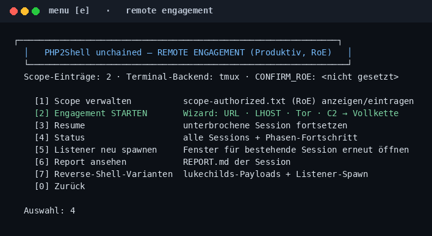

# Remote engagement mode (authorized production hosts)

The compose lab proves the chains in isolation. Security teams also need to run the **same chain** against a real deployment they are **authorized** to test — staging, pre-prod, or a production system covered by written Rules of Engagement. That is what `engage` does.

The probes-only variant (no chaining, no C2) stays in [docs/AUTHORIZED-ASSESSMENT.md](../docs/AUTHORIZED-ASSESSMENT.md) (`assess`). `engage` is the full-chain sibling with the **same scope gate plus an explicit confirmation**.

## Gate (non-negotiable)

Two conditions, enforced by every phase:

1. `scope-authorized.txt` in the repo root contains the target host (exact name, `.domain` suffix, or IPv4 CIDR), ideally with the RoE ticket as a comment.
2. `CONFIRM_ROE=I-AM-AUTHORIZED` in the environment.

No scope entry → exit 3 before the first packet. No confirmation → exit 4 before exploit/post-ex phases.

## Phase chain (incremental + resume)

```text
00 scope+kits ──► 10 recon ──► 20 fingerprint ──► 30 exploit
      │                │              │                 │
      │                │              │                 ▼
      │                │              │          40 foothold (nc + RAAS + tunnel)
      │                │              │                 │
      │                │              │                 ▼
      │                │              │          50 post-ex (Sliver / Tor / detect)
      ▼                ▼              ▼                 ▼
              60 report  ◄── state envs chain every phase together
```

- Each phase writes `out/engage/<sid>/state/<phase>.done` and exports its results (`state/<phase>.env.*`).
- Later phases **hydrate** earlier results (server banner → exploit choice, listener address → post-ex).
- Re-running skips finished phases. `engage resume <sid>` continues an interrupted run.

## Multi-terminal spawning

Phases that need parallel windows (foothold listener, Sliver server/listener/console, log tails) spawn them automatically — one window or pane per job:

| Backend | Detection | Behaviour |
|---------|-----------|-----------|
| `tmux` | preferred | detached session `p2s-<sid>`, one window per job, `tmux attach -t p2s-<sid>` |
| `gnome` | fallback | one `gnome-terminal` window, tab per job |
| `konsole`/`kitty`/`xterm` | fallback | window per job |
| `none` | headless | `nohup` jobs + `logs/<name>.log` + pid files |

Override: `ENGAGE_TERMINAL=tmux|gnome|none`.

## Menu (shell UI)

Main menu key **[e]** opens the engagement console — scope, wizard, resume,
status, listeners, report, RAAS, kits, plus **[9] Sliver**, **[a] Singularity**,
**[b] Lab-External** operations. Everything the orchestrator runs is also
one keypress away here.



Validated end-to-end against a Docker target: [docs/REMOTE-ENGAGEMENT-E2E.md](../docs/REMOTE-ENGAGEMENT-E2E.md).

## Quick start (authorized staging host)

```bash
# 1. Declare RoE scope (gitignored file)
echo 'staging-php.customer-internal.example  # RoE SEC-1234' >> scope-authorized.txt

# 2. Run the full chain (incremental; safe to re-run)
CONFIRM_ROE=I-AM-AUTHORIZED \
ENGAGE_LHOST=10.20.30.40 \
vtbw-php2shell-lab engage run 'https://staging-php.customer-internal.example/index.php'

# 3. Optional profiles (RAAS is on by default)
ENGAGE_TOR=on           # recon/audit via host Tor (127.0.0.1:9050)
ENGAGE_C2=sliver        # host Sliver server+console windows
ENGAGE_TUNNEL=on        # Quick Tunnel in front of the nc listener
ENGAGE_RS=off           # disable lukechilds RAAS extra listener
ENGAGE_SINGULARITY=off  # skip detect playbook
vtbw-php2shell-lab engage kits   # inventory: present vs missing

# 4. Later
vtbw-php2shell-lab engage resume 20261102-090015
vtbw-php2shell-lab engage status
vtbw-php2shell-lab engage listeners 20261102-090015   # re-spawn listener windows
```

Artifacts: `out/engage/<sid>/` — `ENGAGEMENT.md`, `REPORT.md`, `logs/` per phase, terminal job logs.

## What this mode deliberately reuses

| Component | Source |
|-----------|--------|
| FPM PoC chain | `attacker/scripts/php2shell_poc.py` (public research, same as lab) |
| mod_php kit | Zer061 bundle via `fetch-zer061` → `third_party/zer061-php2shell/exploit.py` |
| Fingerprint / WAF | `attacker/scripts/patch_audit.py` **on the host** (not the Docker attacker) |
| Jackalsyn | `fetch-jackalsyn` → `--selftest`; FCGI `--lab` only when RoE exposes FCGI |
| C2 profile | BishopFox Sliver host binaries (`fetch-sliver`) |
| Reverse-shell-as-a-service | [lukechilds/reverse-shell](https://github.com/lukechilds/reverse-shell) + https://reverse-shell.sh |
| Tor egress | host `tor.service` SOCKS5; lab `lab-tor.sh` sidecar only as fallback |
| Quick Tunnel | host `cloudflared` or official Docker image on `--network host` |
| Singularity | `fetch-singularity` + detect checklist — no kernel module load |

Nothing new is invented here — the mode **orchestrates** the lab's public components against a scoped target and keeps evidence in one session directory.

### Wired into `engage` vs lab-only

| Subproject | In `engage`? | How |
|------------|--------------|-----|
| FPM PoC | yes | phase 30 `-t/-p` |
| Patch-Audit | yes | phases 20+30 **host python** (no attacker container) |
| Zer061 | yes if fetched | phase 30; `ZER061_REPO` if upstream 404 |
| Jackalsyn | yes | phase 30 `--selftest`; `--lab` only with `ENGAGE_FCGI_HOST` + `ENGAGE_DTOR` |
| Reverse-shell-as-a-service (lukechilds) | **yes, default on** | phase 40: clone + payload fetch + extra `nc` window |
| Sliver C2 | **default on** (`ENGAGE_C2=sliver`) | phase 50: compose if `:31337`/container busy, else host operator + mTLS/HTTPS + console |
| Tor SOCKS5 | `ENGAGE_TOR=on` | host `:9050`; proof job in phase 50 |
| Cloudflare Quick Tunnel | `ENGAGE_TUNNEL=on` | phase 40 listener tunnel; + sliver-http when C2+sliver |
| Singularity LKM | **default `lab`** | status, detect, `container-up`, shell; `full` needs `CONFIRM_SINGULARITY_ENGAGE=VM-REBOOT-OK` for build |
| `lab-external.sh` | `ENGAGE_EXTERNAL=auto` on lab IPs | phase 50 spawns `external up` (tor + web + sliver tunnels) |

Check: `vtbw-php2shell-lab engage kits` or menu `[e]` → `[8]`.

## Operator checklist (production window)

- [ ] Written RoE covers exploit chaining and post-exploitation, not just probes
- [ ] Change window and rollback plan agreed with the system owner
- [ ] `ENGAGE_LHOST` is reachable from the target (firewall/security groups)
- [ ] SOC/monitoring team informed (or deliberately not — purple team decision, document it)
- [ ] `engage resume` tested once before the window (state hydration works)
- [ ] After: `REPORT.md` archived with the RoE ticket; implants and listeners removed
